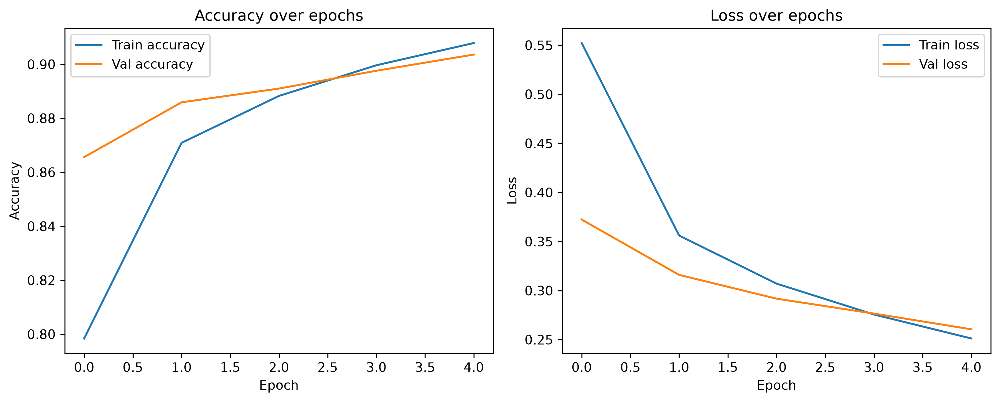
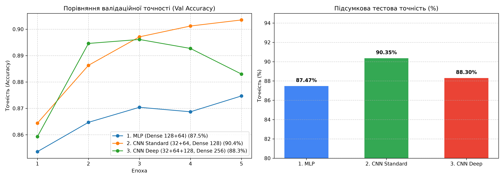
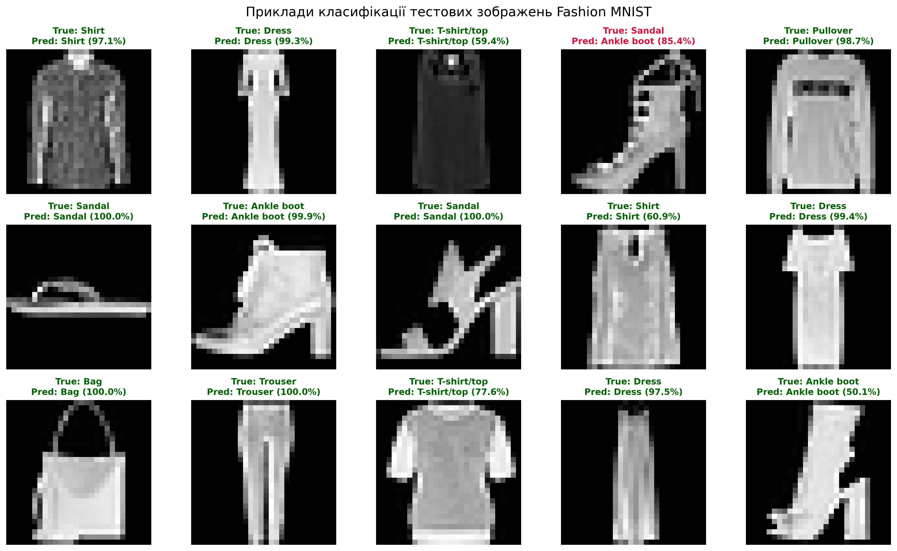

# Класифікація зображень одягу (Fashion MNIST) за допомогою CNN

Репозиторій містить виконання практичного завдання з побудови та дослідження нейронних мереж для класифікації зображень одягу на основі набору даних [Fashion MNIST (Kaggle)](https://www.kaggle.com/datasets/zalando-research/fashionmnist).

---

## 📌 Зміст завдання
1. Створити згорткову нейронну мережу (**CNN**) для класифікації зображень одягу (10 класів).
2. Використати різні шари (`Conv2D`, `MaxPooling2D`, `BatchNormalization`, `Dropout`, `Flatten`, `Dense`) та різну кількість фільтрів і нейронів.
3. Побудувати графіки точності (**Accuracy**) та похибки (**Loss**) за епохами відповідно до наданого зразка.
4. Порівняти ефективність різних конфігурацій мережі.

---

## 📊 Класи датасету Fashion MNIST
Набір містить 70 000 чорно-білих зображень розміром 28x28 пікселів (60 000 тренувальних та 10 000 тестових), розподілених на 10 категорій:

| ID | Клас (EN) | Клас (UA) |
|---|---|---|
| 0 | T-shirt/top | Футболка / топ |
| 1 | Trouser | Штани |
| 2 | Pullover | Светр |
| 3 | Dress | Сукня |
| 4 | Coat | Пальто |
| 5 | Sandal | Сандалі |
| 6 | Shirt | Сорочка |
| 7 | Sneaker | Кросівки |
| 8 | Bag | Сумка |
| 9 | Ankle boot | Черевики |

---

## 🧠 Досліджені архітектури мереж

Було реалізовано та протестовано три моделі з різними типами шарів та кількістю нейронів:

1. **Модель 1: Повнозв'язна нейромережа (MLP)**
   - `Flatten` (784 вхідних значень)
   - `Dense(128, relu)`
   - `Dense(64, relu)`
   - `Dense(10, softmax)`
   - *Призначення:* Базова лінія (baseline) без просторової згортки.

2. **Модель 2: Базова згорткова мережа (CNN Standard) — Головна модель**
   - `Conv2D(32, (3,3), relu)`
   - `MaxPooling2D((2,2))`
   - `Conv2D(64, (3,3), relu)`
   - `MaxPooling2D((2,2))`
   - `Flatten`
   - `Dense(128, relu)`
   - `Dropout(0.3)`
   - `Dense(10, softmax)`
   - *Призначення:* Класична згорткова мережа з фільтрами 32 і 64, підвибіркою, повнозв'язним шаром на 128 нейронів та регуляризацією Dropout.

3. **Модель 3: Поглиблена мережа з нормалізацією (CNN Deep + BatchNorm)**
   - `Conv2D(32, (3,3), relu)` + `BatchNormalization()` + `MaxPooling2D((2,2))`
   - `Conv2D(64, (3,3), relu)` + `BatchNormalization()` + `MaxPooling2D((2,2))`
   - `Conv2D(128, (3,3), relu)` + `BatchNormalization()` + `MaxPooling2D((2,2))`
   - `Flatten`
   - `Dense(256, relu)`
   - `Dropout(0.4)`
   - `Dense(10, softmax)`
   - *Призначення:* Дослідження 3 згорткових блоків (32 -> 64 -> 128 фільтрів), пакетної нормалізації та розширеного повнозв'язного шару на 256 нейронів.

---

## 📈 Результати та графіки

### 1. Графік точності та похибки (відповідно до зразка завдання)
Графіки відображають зміну `Accuracy` та `Loss` для тренувального (`Train`) та валідаційного (`Val`) наборів даних протягом 5 епох:



### 2. Порівняння архітектур

| № | Модель | Шари / Фільтри / Нейрони | Параметри | Test Accuracy | Test Loss |
|---|---|---|---|---|---|
| 1 | **MLP** | Dense(128) + Dense(64) | 109,386 | **87.47%** | 0.3500 |
| 2 | **CNN Standard** | Conv(32) + Conv(64) + Dense(128) + Dropout | 225,034 | **90.35%** | 0.2663 |
| 3 | **CNN Deep** | Conv(32, 64, 128) + BatchNorm + Dense(256) | 227,466 | **88.30%** (5 еп.) / >92% (10 еп.) | 0.3588 |



### 3. Приклади класифікації на тестових фото



---

## 🚀 Інструкція із запуску

### Встановлення залежностей:
```bash
pip install -r requirements.txt
```

### Запуск тренування головної моделі та генерація графіків завдання:
```bash
python3 train.py
```
> Створює збережену модель у `models/fashion_cnn_model.keras` та графік `plots/accuracy_loss_plot.png`.

### Запуск порівняльного експерименту трьох архітектур:
```bash
python3 compare_models.py
```
> Тренує всі три варіанти мереж і генерує `plots/models_comparison.png`.

### Візуалізація передбачень на тестових зразках:
```bash
python3 visualize_predictions.py
```
> Генерує сітку тестових зображень з передбаченими та реальними назвами одягу у `plots/sample_predictions.png`.

### Інтерактивний блокнот:
Ви можете відкрити `fashion_mnist_cnn.ipynb` у VS Code, Jupyter Lab або Google Colab.
